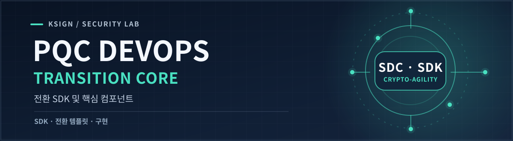
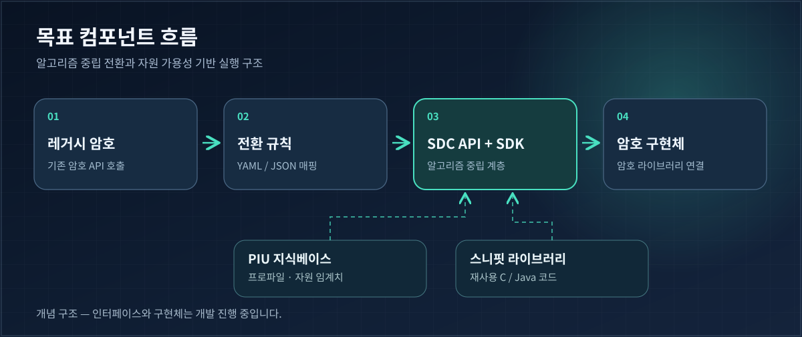

<p align="right">🌐 <a href="./README.md">English</a> · <strong>한국어</strong></p>



<p align="center">
  <a href="https://github.com/KSign-Security-Lab/pqc-devops-core/issues"></a>
  <a href="https://github.com/KSign-Security-Lab/pqc-devops-guide"></a>
  <a href="./LICENSE"></a>
</p>

**DevOps 기반 양자내성암호(PQC) 전환을 위한 핵심 구현 저장소입니다.** Crypto-Agility SDK, 레거시-SDC API 전환 템플릿, C/Java 스니핏, PIU 지식베이스를 개발하는 것을 목표로 합니다.

> **프로젝트 단계:** 초기 구현 작업을 Issue로 관리하고 있습니다. 현재 저장소에는 **실행 가능한 SDK나 배포된 패키지가 아직 없습니다.**

<p align="center">
  <a href="#목표-아키텍처">아키텍처</a> ·
  <a href="#개발-대상-컴포넌트">컴포넌트</a> ·
  <a href="#구현-원칙">구현 원칙</a> ·
  <a href="https://github.com/KSign-Security-Lab/pqc-devops-core/issues">로드맵 ↗</a>
</p>

## 개발 목적

PQC 전환 과정에서 애플리케이션이 특정 암호 라이브러리에 직접 종속되는 문제를 줄이는 것이 목표입니다. 비즈니스 로직에 암호 구현체를 고정하는 대신, 공통 API와 재사용 가능한 전환 컴포넌트를 제공하는 구조를 지향합니다.

**[Guide 저장소](https://github.com/KSign-Security-Lab/pqc-devops-guide)**는 공정·API·CI 구조·검증 기준을 정의하고, **Core**는 그 명세를 기반으로 필요한 기능을 구현합니다.

## 목표 아키텍처



*구현 목표를 설명하는 개념도입니다. 위 컴포넌트가 모두 구현되었다는 의미는 아닙니다.*

### 전환 흐름

1. **탐지·매핑:** YAML/JSON 전환 규칙으로 레거시 암호 API 호출을 탐지하고 SDC-API 호출로 매핑합니다.
2. **표준 API 계층:** 애플리케이션 코드와 실제 암호 구현체 사이에 알고리즘 중립 인터페이스를 정의합니다.
3. **동적 구현체 연동:** Crypto-Agility SDK를 통해 암호 라이브러리를 선택·연결할 수 있는 구조를 설계합니다.
4. **자원 제약 평가:** PIU 프로파일, 구현 메타데이터, C/Java 스니핏을 활용해 자원 요구사항을 점검합니다.

## 개발 대상 컴포넌트

| 컴포넌트 | 개발 범위 | Issue |
|:--|:--|:--|
| **전환 템플릿** | 레거시 암호 API 탐지 및 표준 SDC-API 매핑을 위한 YAML/JSON 규칙 | [#3](https://github.com/KSign-Security-Lab/pqc-devops-core/issues/3) |
| **PQC 스니핏 라이브러리** | C/Java 재사용 코드, 최악 조건 자원 예약(WCRR), 하드웨어별 자원 할당 전략 | [#4](https://github.com/KSign-Security-Lab/pqc-devops-core/issues/4) |
| **Crypto-Agility SDK** | 알고리즘 중립 API 접근, 동적 라이브러리 바인딩, 자원 가용성 검사 | [#5](https://github.com/KSign-Security-Lab/pqc-devops-core/issues/5) |
| **PIU 지식베이스** | PIU 메타데이터, 알고리즘, 하드웨어 프로파일, 임계치, 검증 데이터의 SSOT | [#7](https://github.com/KSign-Security-Lab/pqc-devops-core/issues/7) |

위 항목은 **개발 예정 산출물**입니다. 세부 범위와 완료 조건은 각 Issue를 기준으로 관리합니다.

## 구현 원칙

| 원칙 | 설계 방향 |
|:--|:--|
| **알고리즘 중립성** | 애플리케이션에 노출되는 인터페이스와 암호 구현체의 선택을 분리합니다. |
| **통제 가능한 전환** | API 탐지·매핑 규칙을 검토할 수 있는 YAML/JSON 파일로 표현합니다. |
| **자원 가용성** | SDK 과제에서 제시된 `A + B ≤ C` 안전 조건을 검토합니다. 각 변수의 정의와 적용 방식은 추후 명세에서 확정합니다. |
| **하드웨어별 재사용성** | C/Java 스니핏과 PIU 프로파일 정보를 자원 할당·검증 과정에 연결합니다. |
| **추적성** | 구현 변경사항을 [Guide 명세](https://github.com/KSign-Security-Lab/pqc-devops-guide/issues) 및 검증 증적과 연결합니다. |

## 개발 참여

**저장소 확인하기**

```bash
git clone https://github.com/KSign-Security-Lab/pqc-devops-core.git
cd pqc-devops-core
```

현재는 설치·빌드·실행 명령이 없습니다. SDK 프로토타입이 공개되기 전에는 **[구현 Issue](https://github.com/KSign-Security-Lab/pqc-devops-core/issues)**를 기준으로 작업합니다.

**작업 흐름**

1. 관련 [Guide 설계 Issue](https://github.com/KSign-Security-Lab/pqc-devops-guide/issues)와 요구사항을 확인합니다.
2. [Core 구현 Issue](https://github.com/KSign-Security-Lab/pqc-devops-core/issues)를 선택하고 API 및 데이터 경계를 명확히 합니다.
3. 컴포넌트 구현 단계에서 테스트와 자원 측정 결과를 추가합니다.
4. 요구사항과 검증 증적을 연결한 Pull Request로 변경사항을 제출합니다.

## 연관 자료

- **[PQC DevOps Guide](https://github.com/KSign-Security-Lab/pqc-devops-guide)** — 설계 명세, 아키텍처, CI 연동, 거버넌스.
- **[NIST PQC 프로젝트](https://csrc.nist.gov/projects/post-quantum-cryptography/)** — 외부 표준 참고 자료이며, 구현의 표준 준수·인증을 의미하지 않습니다.

---

<sub>**KSign Security Lab** · <a href="./LICENSE">Apache License 2.0</a></sub>

