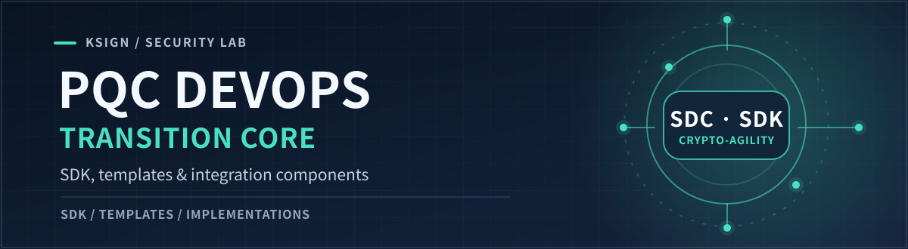
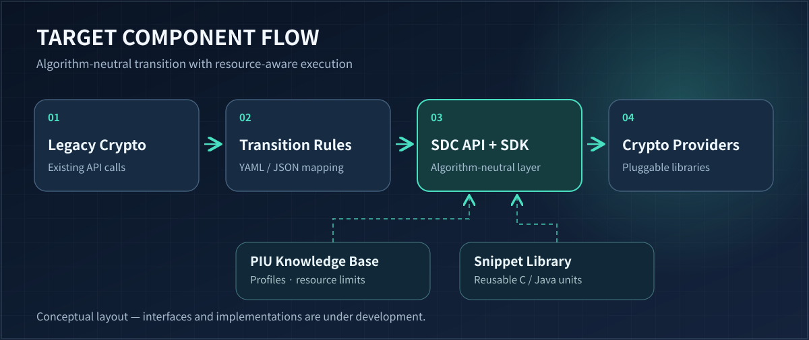

<p align="right">🌐 <strong>English</strong> · <a href="./README.ko.md">한국어</a></p>



<p align="center">
  <a href="https://github.com/KSign-Security-Lab/pqc-devops-core/issues"></a>
  <a href="https://github.com/KSign-Security-Lab/pqc-devops-guide"></a>
  <a href="./LICENSE"></a>
</p>

**The planned implementation layer for DevOps-driven post-quantum cryptography (PQC) transition.** It brings together a Crypto-Agility SDK, legacy-to-SDC API mapping templates, reusable C/Java snippets, and a PIU knowledge base.

> **Project stage:** Initial implementation work is tracked in issues. This repository **does not yet contain a runnable SDK or published packages**.

<p align="center">
  <a href="#target-architecture">Architecture</a> ·
  <a href="#planned-components">Components</a> ·
  <a href="#implementation-principles">Principles</a> ·
  <a href="https://github.com/KSign-Security-Lab/pqc-devops-core/issues">Roadmap ↗</a>
</p>

## What this repository builds

The goal is to reduce application-level coupling to specific cryptographic libraries during PQC migration. Rather than embedding a particular provider across business logic, the target system defines a standardized integration surface and reusable transition components.

The **[Guide repository](https://github.com/KSign-Security-Lab/pqc-devops-guide)** owns the process definitions, interface specifications, CI architecture, and verification criteria. **Core** turns selected specifications into implementations.

## Target architecture



*Target component flow. The diagram describes intended responsibilities; it does not assert that these modules already exist.*

### Transition path

1. **Detect and map** legacy cryptographic API calls using versioned YAML/JSON transition rules.
2. **Use a standardized API boundary** to separate application code from specific cryptographic implementations.
3. **Bind cryptographic providers** through the proposed Crypto-Agility SDK without hardwiring an algorithm to business logic.
4. **Evaluate resource constraints** using PIU profiles, implementation metadata, and reusable C/Java snippets.

## Planned components

| Component | Responsibilities | Issue |
|:--|:--|:--|
| **Transition Templates** | YAML/JSON rules for detecting legacy calls and mapping them to standardized SDC APIs | [#3](https://github.com/KSign-Security-Lab/pqc-devops-core/issues/3) |
| **PQC Snippet Library** | Reusable C/Java examples, Worst Condition Resource Reservation (WCRR), hardware-aware allocation strategies | [#4](https://github.com/KSign-Security-Lab/pqc-devops-core/issues/4) |
| **Crypto-Agility SDK** | Algorithm-neutral access, dynamic library binding, and resource-availability checks | [#5](https://github.com/KSign-Security-Lab/pqc-devops-core/issues/5) |
| **PIU Knowledge Base** | Single Source of Truth (SSOT) for PIU metadata, algorithms, hardware profiles, thresholds, and verification data | [#7](https://github.com/KSign-Security-Lab/pqc-devops-core/issues/7) |

These are **planned deliverables**. Individual issues remain the source of truth for the precise scope and acceptance criteria.

## Implementation principles

| Principle | Planned design direction |
|:--|:--|
| **Algorithm neutrality** | Keep application-facing interfaces distinct from crypto-provider selection. |
| **Controlled migration** | Express call-detection and mapping decisions as reviewable YAML/JSON rules. |
| **Resource awareness** | Evaluate the `A + B ≤ C` safety condition proposed for the SDK; variable definitions and enforcement behavior remain to be specified. |
| **Hardware-aware reuse** | Connect C/Java snippets and PIU profiling data to resource allocation and verification decisions. |
| **Traceability** | Tie implementation changes to [Guide specifications](https://github.com/KSign-Security-Lab/pqc-devops-guide/issues) and issue-level verification evidence. |

## Get involved

**Browse the scaffold**

```bash
git clone https://github.com/KSign-Security-Lab/pqc-devops-core.git
cd pqc-devops-core
```

There is no install, build, or execution command yet. Until the SDK prototype is published, contribution starts with the **[implementation issue tracker](https://github.com/KSign-Security-Lab/pqc-devops-core/issues)**.

**Development loop**

1. Read the related [Guide specification issue](https://github.com/KSign-Security-Lab/pqc-devops-guide/issues).
2. Select a [Core implementation issue](https://github.com/KSign-Security-Lab/pqc-devops-core/issues) and describe the proposed API/data boundary.
3. Add implementation, tests, and resource measurements as the component becomes available.
4. Open a pull request linking the requirement and the corresponding verification evidence.

## Related resources

- **[PQC DevOps Guide](https://github.com/KSign-Security-Lab/pqc-devops-guide)** — specifications, architecture, CI integration, and governance.
- **[NIST PQC project](https://csrc.nist.gov/projects/post-quantum-cryptography/)** — external standards context, **not** an implementation conformance claim.

---

<sub>Maintained by **KSign Security Lab** · Licensed under <a href="./LICENSE">Apache License 2.0</a>.</sub>

